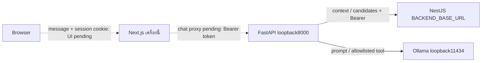

# Service1 — Chat และ Recommendation

สถานะ: implement FastAPI → Qwen3 4B/Ollama native Tool Calling → authenticated NestJS Database Filtering แล้ว. Search, conversation memory และการเชื่อมหน้าเว็บยังรอทำเพิ่มเติม. กติกาล่าสุดแทนแบบ unvisited-only เดิม ดู [decisions](../docs/decisions.md#2026-10-12--recommendation-implementation-three-new-two-repeat)

## พฤติกรรม

| ข้อความ                             | การทำงาน                                                                              | ผลลัพธ์                      |
| ----------------------------------- | ------------------------------------------------------------------------------------- | ---------------------------- |
| ทักทาย/ถามเกี่ยวกับระบบโดยไม่ขอร้าน | โมเดลตอบในขอบเขตและแจ้งเมื่อไม่มีข้อมูล                                               | reply, storeIds ว่าง         |
| ขอแนะนำร้าน                         | โมเดลตีความหนึ่งหรือหลาย categoryIds จาก master → read tool → Backend คัดและจัดอันดับ | reply และ storeIds ไม่เกิน 5 |
| ขอร้านโดยไม่บอกประเภท               | ใช้ประเภทจากประวัติได้ ถ้ายังไม่ชัดให้ถามเพิ่ม                                        | ไม่มีการค้นแบบสุ่มประเภท     |
| ข้อมูลภายนอกที่ต้องตรวจล่าสุด       | แจ้งว่าต้องตรวจแหล่งข้อมูล ยังไม่มี Search tool                                       | reply, storeIds ว่าง         |
| นอกเรื่อง เช่น “หมาผมน่ารักไหม”     | แจ้งขอบเขตอย่างสุภาพ                                                                  | reply, storeIds ว่าง         |

ทุก `/chat` ต้องใช้ CUSTOMER Bearer token. ไม่มีการรับ userId, role, ประวัติที่ผู้ใช้ส่งเอง หรือ arbitrary URL/SQL ใน body/tool. Request มีเฉพาะ `message`; Backend อ่านตัวตนและประวัติจาก token

## Workflow ที่ implement

1. FastAPI เรียก `GET /recommendations/context` ด้วย token. NestJS ตรวจ JWT และ ACTIVE account ผ่าน AuthService.me รวมทั้ง CUSTOMER role **ก่อน** อ่านข้อมูล. ถ้าตรวจไม่ได้ หยุดก่อน inference
2. Context ประกอบด้วย category masters และประวัติ 20 ร้านล่าสุดแบบสรุป (storeId/categoryIds/count/date). ไม่ส่ง credential หรือ user profile เข้า prompt. Purchase schema ไม่มีสินค้าเป็นรายการ จึงรู้ว่าเคยซื้อจากร้าน/ประเภทใด แต่ระบุสินค้าที่ซื้อจริงไม่ได้
3. Qwen3 ตีความ message; ถ้าขอร้าน เรียกได้เพียง `search_system_shops({categoryIds})` หนึ่งครั้ง. Server ตรวจ allowlist, รูปแบบ, ความซ้ำ และรหัสประเภทจริงสูงสุด 10 ประเภท. ไม่อนุญาต parallel/recursive tools
4. Tool ส่ง `POST /recommendations/candidates` ด้วย token เดิม. Backend คัดร้าน APPROVED ที่มีประเภทตรงอย่างน้อยหนึ่งประเภท (OR). SQL ตรวจประวัติทุกเดือน แบ่งใหม่/เคยซื้อ แล้วเลือก **ใหม่ไม่เกิน 3 + เคยซื้อไม่เกิน 2**. ขาดโควตาใดไม่เติมจากอีกกลุ่ม
5. “เคยซื้อ” สำหรับ recommendation คือรายการ SUCCEEDED/REFUNDED ที่มี confirmed_at; PENDING/FAILED ไม่ใช่การเคยซื้อ. เป็นนิยามการเคยไปร้าน ไม่เปลี่ยนกฎ award/reversal ของ Coins
6. อ่าน new_customer_coins หรือ repeat_customer_coins จาก shop_coin_rates ในรอบ active แบบ `[starts_at, ends_at)`. จัดอันดับ Coins ที่ทราบสูงก่อน, ไม่ทราบท้าย, เสมอเรียง numeric shop ID. เลือกภายในแต่ละกลุ่มแล้วเรียงผลรวมด้วยหลักเดียวกัน. ไม่มี rate ไม่คำนวณหรือรับประกัน Coins ขึ้นเอง
7. FastAPI ตรวจ candidate DTO/โควตา/IDs ไม่ซ้ำ. รหัสตอบกลับมาจาก Backend เท่านั้น. ส่งเฉพาะจำนวนร้านใหม่/ร้านเดิมให้โมเดลเรียบเรียงข้อความรอบสุดท้าย โดยไม่ให้ tool รอบใหม่; รวมสูงสุดสอง inference calls. ไม่มีร้านคืน empty พร้อมข้อความจาก server โดยไม่เรียกโมเดลรอบสอง

```json
{
  "reply": "พบร้านใหม่ 2 ร้านและร้านที่เคยซื้อ 1 ร้านครับ",
  "storeIds": ["101", "205", "310"],
  "mode": "model",
  "model": "qwen3:4b"
}
```

ตัวอย่าง IDs เป็นเพียงรูปแบบ. ข้อมูล recommendation มีแค่ string IDs ให้ frontend สร้าง card เอง ไม่คืนชื่อ/รายละเอียดร้าน/Coins ใน card payload. คง mode/model สำหรับ compatibility. ยังไม่มี store-by-ID/card API

## Backend APIs ที่ตรวจพบ — 12 ต.ค. 2569

ตรวจจาก controllers/services ไม่ใช่ยืนยันว่า deployment/DB พร้อม. NestJS ไม่มี global prefix; PORT default3000

| API                              | ใช้ทำอะไร                                        | Token / Auth                         |
| -------------------------------- | ------------------------------------------------ | ------------------------------------ |
| GET /                            | Scaffold Hello World                             | ไม่ต้อง                              |
| POST /auth/register              | สมัครสามบทบาท คืน user ไม่มี token               | ไม่ต้อง                              |
| POST /auth/login                 | ตรวจบัญชี คืน accessToken อายุ 1 ชั่วโมง         | ไม่ต้องแนบ token เดิม                |
| GET /me                          | ตรวจ session คืน id/role/displayName             | Bearer ทั้งสามบทบาท                  |
| GET /categories                  | category masters                                 | ไม่ต้อง                              |
| GET /geocoding/reverse           | แปลงพิกัดเป็นที่อยู่สำหรับสมัครร้าน              | ไม่ต้อง                              |
| GET /stores                      | APPROVED ในรัศมี สูงสุด50 เรียงใกล้ก่อน          | CUSTOMER Bearer                      |
| GET /government/coin-rules       | อ่าน rules/periods/rates                         | GOVERNMENT Bearer                    |
| POST /government/coin-rules      | เขียนกฎรอบถัดไป                                  | GOVERNMENT Bearer ไม่ใช่ tool ของ AI |
| GET /recommendations/context     | ตัวตน, categories, ประวัติร้านที่ซื้อแบบสรุป     | CUSTOMER Bearer                      |
| POST /recommendations/candidates | กรองประเภท/visited/3+2 และจัดอันดับ rates จาก DB | CUSTOMER Bearer                      |

JWT ตรวจ signature/issuer/audience/expiry และ ACTIVE/current role ซ้ำจาก DB. Token หาย/ผิด/หมดอายุ401, ข้าม role403. ไม่มี Backend logout/refresh; Next logout ล้าง HttpOnly cookie. ไม่มีการใช้ government token ข้ามสิทธิ์ให้ลูกค้า

## เว็บและ AI รันบนเครื่องนี้



BACKEND_BASE_URL implement แล้วและเป็น server-only; ต้องชี้ NestJS ตาม PORT จริง ไม่ใช่ Next.js. ถ้าอยู่เครื่องนี้ใช้ loopbackและพอร์ตแยกจากเว็บ/AI. เว็บต้องเพิ่ม Next chat proxy อ่าน HttpOnly session แล้วแนบ Bearer ตามแนวเดียวกับ `/api/stores`; AI_SERVICE_URL ฝั่งเว็บยังเป็นข้อเสนอ ไม่มี tunnel

## ข้อจำกัดและงานต่อ

- ไม่มีบทสนทนาต่อเนื่อง, Search, project-information tools, พิกัด/ระยะทาง, ราคา หรือ product-level filtering. Prompt ต้องไม่อ้างว่าได้ตรวจเงื่อนไขเหล่านี้
- ผลตอบกลับเป็นภาษาธรรมชาติจากโมเดล ต้องประเมินข้อความกำกวม/ปนหลายเจตนา/คำสั่งแฝงเพิ่ม. ข้อมูลร้าน/ประเภท/ประวัติเป็น untrusted values ไม่ใช่คำสั่ง
- Backend/tool error หยุดคำขอ; โมเดลล่มไม่แต่ง reply/history/IDs ทดแทน. ยังไม่มี semantic deterministic fallback เมื่อ provider ตีความประเภทไม่ได้
- Unit transport/auth/SQL-scope tests และ real-Qwen fixture smoke มีแล้ว. Live PostgreSQL test เป็น opt-in ใช้ TEMP tables แต่รอบนี้ยังไม่ผ่านการรันเพราะไม่มี development DATABASE_URL; live Backend + model + web E2E/review/load gates ยังไม่ผ่าน จึงคง F07/F13 PARTIAL

คำสั่งรันและตรวจอยู่ใน [README](README.md), DTO/status ใน [API contract](../docs/api-contract.md), progress ใน [PLAN](../PLAN/PLAN.md)
