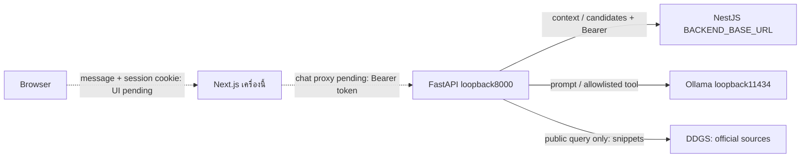

# Service1 — Chat และ Recommendation

## Explore search (29 October 2026)

Explore uses FastAPI `POST /stores/search`, independent of chat's tool orchestration and 3+2 selection. Per request: CUSTOMER `/me` verification → one all-category `/stores` page (50 shops, selected radius) → shared full-description relevance evaluation → every selected ID plus discovery pagination metadata. The web follows all pages, including empty match pages, then hydrates every selected ID through scoped `/stores/batch`. No total result cap, purchase-history reads, Coins ranking or public DDGS search; errors remain explicit with no fabricated fallback. The old Nest `/recommendations/search` remains paused. See the current [API contract](../docs/api-contract.md#explore-all-match-search-29-october-2026) for validation/error details. Web chat/Explore integration exists; live model/browser E2E and conversation memory remain pending.

สถานะ: implement FastAPI → Qwen3 4B/Ollama native Tool Calling → authenticated NestJS Database Filtering และ DDGS public Search แล้ว. หน้าแชต/Explore เชื่อมแล้ว; conversation memory และ live E2E ยังรอทำเพิ่มเติม. กติกาล่าสุดแทนแบบ unvisited-only เดิม ดู [recommendation decisions](../docs/decisions.md#2026-10-12--recommendation-implementation-three-new-two-repeat) และ [Search decisions](../docs/decisions.md#2026-10-12--related-public-web-search-and-four-chat-examples)

## พฤติกรรม

| ข้อความ                                      | การทำงาน                                                                              | ผลลัพธ์                       |
| -------------------------------------------- | ------------------------------------------------------------------------------------- | ----------------------------- |
| ทักทาย/ถามเกี่ยวกับระบบโดยไม่ขอร้าน          | โมเดลตอบในขอบเขตและแจ้งเมื่อไม่มีข้อมูล                                               | reply, storeIds ว่าง          |
| ขอแนะนำร้าน                                  | โมเดลตีความหนึ่งหรือหลาย categoryIds จาก master → read tool → Backend คัดและจัดอันดับ | reply และ storeIds ไม่เกิน 5  |
| ขอร้านโดยไม่บอกประเภท                        | ใช้ประเภทจากประวัติได้ ถ้ายังไม่ชัดให้ถามเพิ่ม                                        | ไม่มีการค้นแบบสุ่มประเภท      |
| ข้อมูลสาธารณะเรื่องโครงการช่วยจ่าย/พร้อมเพย์ | search_related_web ผ่าน DDGS แล้วสรุปพร้อมอ้างอิง                                     | reply, sources, storeIds ว่าง |
| ถามข้อมูลสาธารณะพร้อมขอร้าน                  | ใช้ Search และ DB tools อย่างละหนึ่งครั้ง                                             | reply, sources, storeIds      |
| นอกเรื่อง เช่น “หมาผมน่ารักไหม”              | แจ้งขอบเขตอย่างสุภาพ                                                                  | reply, storeIds ว่าง          |

ทุก `/chat` ต้องใช้ CUSTOMER Bearer token. ไม่มีการรับ userId, role, ประวัติที่ผู้ใช้ส่งเอง หรือ arbitrary URL/SQL ใน body/tool. Request มี `message` และ optional `location:{latitude,longitude,radiusKm}`; Backend อ่านตัวตนและประวัติจาก token. ไม่มี location จะปิด shop tool และแจ้งว่าต้องอนุญาตตำแหน่งปัจจุบันหรือส่งพิกัดมาก่อน โดยยังคุยทั่วไป/ค้นเว็บได้ พิกัดไม่เข้า prompt และโมเดลเปลี่ยนขอบเขตไม่ได้ `/chat/test` ยังเป็น message-only หน้าเว็บใช้ตำแหน่งอุปกรณ์ตอนส่งข้อความ/ส่งใหม่ รัศมี5กม. ไม่มี picker แล้ว ส่วน direct API clients ยังส่ง location DTO ได้ตามเดิม

## Token-free model test

`POST /chat/test` ใช้ request/response เดียวกับ `/chat` แต่ไม่ต้องแนบ token และไม่มี Backend dependency. สำหรับทดลอง plain chat/public Search/off-topic โดยไม่ต้องเปิด Backend/DB. ไม่สร้าง actor/history/categories สมมติ; ส่ง system instruction ว่าไม่มี authenticated context. มีเพียง search_related_web ตาม scope เดิม อย่างละหนึ่ง call/รวมสอง inference calls; ไม่มี search_system_shops ใน tools และ reject หากโมเดลพยายามเรียกด้วย502. ขอร้านให้แจ้งว่าใช้ `/chat` พร้อม CUSTOMER token. Response `storeIds: []` เสมอ; `sources` เป็นผลค้นที่ผ่านการตรวจเดิม. ไม่เปลี่ยน auth ของ `/chat` หรือเปิด tunnel. คำสั่งและตัวอย่างอยู่ใน [README](README.md#ทดสอบโมเดลโดยไม่แนบ-token)

## Workflow ที่ implement

1. FastAPI เรียก `GET /recommendations/context` ด้วย token. NestJS ตรวจ JWT และ ACTIVE account ผ่าน AuthService.me รวมทั้ง CUSTOMER role **ก่อน** อ่านข้อมูล. ถ้าตรวจไม่ได้ หยุดก่อน inference
2. Context ประกอบด้วย category masters และประวัติ 20 ร้านล่าสุดแบบสรุป (storeId/categoryIds/count/date). ไม่ส่ง credential หรือ user profile เข้า prompt. Purchase schema ไม่มีสินค้าเป็นรายการ จึงรู้ว่าเคยซื้อจากร้าน/ประเภทใด แต่ระบุสินค้าที่ซื้อจริงไม่ได้
3. Qwen3 ตีความ message; ถ้าขอร้าน ใช้ `search_system_shops({categoryIds})`. คำถามที่มี public-topic marker จะมี `search_related_web({query})` ให้เลือกเพิ่ม. Server ตรวจ allowlist/arguments/ประเภทจริงสูงสุด 10 ประเภท; ไม่รับ actor/URL/SQL. แต่ละ conversational tool ใช้ได้หนึ่งครั้ง และ orchestration สูงสุดสาม inference calls ส่วน discovery/relevance เป็นขั้นตอนภายใน shop tool เพิ่มเติม เรียกต่าง tool ใน batch เดียวหรือสองรอบได้; ปฏิเสธการเรียกซ้ำ/ไม่รู้จัก/เกินงบ
4. Shop tool เรียก `GET /stores` จริงด้วย categoryIds/location ที่ server ผูกไว้ อ่านครบทุกหน้าสูงสุด 200 ร้านก่อนโควตา ส่งเฉพาะ id/name/categories/description และ message ต้นฉบับให้ relevance inference ซึ่งรวมได้ทั้งร้านที่ตรงและอาจเกี่ยวข้อง เช่น ขอ “กะเพรา” เลือกร้าน “ตามสั่ง/อาหารไทย” ได้ ไม่ต้องตรงคำ 100% ไม่รับรองเมนู จากนั้นส่ง shopIds ที่ผ่านไป `POST /recommendations/candidates` ด้วย token/categoryIds/location เดิม Backend rebuild scope APPROVED/category OR/รัศมี 0.1–50 กม. ค่าเริ่มต้น 5 กม. และใช้ shopIds จำกัดให้แคบลงเท่านั้น ก่อนตรวจประวัติทุกเดือน จัด Coins และเลือก **ใหม่ไม่เกิน 3 + เคยซื้อไม่เกิน 2** ไม่เติมร้านที่ไม่เกี่ยวข้องหรือขยายระยะ
   - Relevance ใช้ชุดไม่เกิน20ร้าน/12000ตัวอักษร JSON สูงสุด20 inference calls ใช้ OLLAMA_* เดิม เก็บ description เต็ม ไม่ส่งประวัติ/พิกัด/Coins ให้ตัวประเมิน ทุก ID ต้องอยู่ในชุดที่ส่ง ไม่มี exact-keyword fallback; ขอบเขตเกินงบ503 ข้อมูล/IDsผิด502 provider503/504ตามเดิม การประเมินคัด eligibility เท่านั้น ไม่เปลี่ยน Coins ranking; description เป็น untrusted data
5. “เคยซื้อ” สำหรับ recommendation คือรายการ SUCCEEDED/REFUNDED ที่มี confirmed_at; PENDING/FAILED ไม่ใช่การเคยซื้อ. เป็นนิยามการเคยไปร้าน ไม่เปลี่ยนกฎ award/reversal ของ Coins
6. อ่าน new_customer_coins หรือ repeat_customer_coins จาก shop_coin_rates ในรอบ active แบบ `[starts_at, ends_at)`. จัดอันดับ Coins ที่ทราบสูงก่อน, ไม่ทราบท้าย, เสมอเรียง numeric shop ID. เลือกภายในแต่ละกลุ่มแล้วเรียงผลรวมด้วยหลักเดียวกัน. ไม่มี rate ไม่คำนวณหรือรับประกัน Coins ขึ้นเอง
7. FastAPI ตรวจ candidate DTO/โควตา/IDs ไม่ซ้ำ. รหัสตอบกลับมาจาก Backend เท่านั้น. ส่งเฉพาะจำนวนร้านใหม่/ร้านเดิมให้โมเดลเรียบเรียง ไม่ส่งชื่อ/รหัสร้านจาก candidates. ถ้าไม่มีร้านและไม่ได้ถามข้อมูลภายนอก คืน empty จาก server; ถ้าถามข้อมูลภายนอกด้วย ให้ทำ tool ที่เหลือได้
8. Search ตรวจข้อความต้นฉบับและคำค้นด้วย lexical public-topic/obvious-personal-data guards. ไม่ส่ง token/profile/history object ไป provider. DDGS ลอง DuckDuckGo แล้ว Yahoo ด้วยคำค้นเดิมจำกัด go.th/bot.or.th/krungthai.com สูงสุดสอง upstream attempts. ใช้ snippets ไม่ fetch arbitrary URLs; เก็บเฉพาะ HTTPS official links ที่ตรวจแล้ว จำกัดแหล่ง 3 (ตั้งได้1–5), timeout15s (1–30), workers2 ต่อ process ไม่มี queue ไม่จำกัด
9. โมเดลได้ title/snippet/reference เพื่อสรุปพร้อม [1] [2]. Server ตรวจเลขอ้างอิงและไม่ให้โมเดลสร้าง URL เอง แล้วแนบลิงก์จริงและ sources. Citation validation ตรวจ link/reference ไม่ใช่ full factual verification; กำกับว่าผลค้นอาจเก่า. ถ้าผิดรูปแบบคืนข้อความให้อ่านแหล่งแทน; ถ้า Search ปิด/blocked/timeout/empty คืนข้อจำกัด ไม่แต่งข้อมูล และไม่ทิ้ง storeIds ที่ได้แล้ว

```json
{
  "reply": "พบร้านใหม่ 2 ร้านและร้านที่เคยซื้อ 1 ร้านครับ",
  "storeIds": ["101", "205", "310"],
  "sources": [],
  "mode": "model",
  "model": "qwen3:4b"
}
```

ตัวอย่าง IDs เป็นเพียงรูปแบบ. ข้อมูล recommendation มีแค่ string IDs ให้ frontend สร้าง card เอง ไม่คืนชื่อ/รายละเอียดร้าน/Coins ใน card payload. คง mode/model สำหรับ compatibility. ยังไม่มี store-by-ID/card API

Search คืน `sources: [{title,url}]` จากผลจริง; plain chat/recommendation/off-topic ไม่ค้นเว็บใช้ `sources: []`. ไม่มี `/search` endpoint แยก. ตัวอย่างคำถามทั้งสี่แบบและ combined/empty/error cases อยู่ใน [README](README.md#ตัวอย่างคำถามครบ-4-รูปแบบ)

## Backend APIs ที่ตรวจพบ — 12 ต.ค. 2569

ตรวจจาก controllers/services ไม่ใช่ยืนยันว่า deployment/DB พร้อม. NestJS ไม่มี global prefix; PORT default3000

| API                              | ใช้ทำอะไร                                                                     | Token / Auth                         |
| -------------------------------- | ----------------------------------------------------------------------------- | ------------------------------------ |
| GET /                            | Scaffold Hello World                                                          | ไม่ต้อง                              |
| POST /auth/register              | สมัครสามบทบาท คืน user ไม่มี token                                            | ไม่ต้อง                              |
| POST /auth/login                 | ตรวจบัญชี คืน accessToken อายุ 1 ชั่วโมง                                      | ไม่ต้องแนบ token เดิม                |
| GET /me                          | ตรวจ session คืน id/role/displayName                                          | Bearer ทั้งสามบทบาท                  |
| GET /categories                  | category masters                                                              | ไม่ต้อง                              |
| GET /geocoding/reverse           | แปลงพิกัดเป็นที่อยู่สำหรับสมัครร้าน                                           | ไม่ต้อง                              |
| GET /stores                      | APPROVED ในรัศมี แบ่งหน้า default50/max100 เรียงใกล้ก่อน                      | CUSTOMER Bearer                      |
| GET /government/coin-rules       | อ่าน rules/periods/rates                                                      | GOVERNMENT Bearer                    |
| POST /government/coin-rules      | เขียนกฎรอบถัดไป                                                               | GOVERNMENT Bearer ไม่ใช่ tool ของ AI |
| GET /recommendations/context     | ตัวตน, categories, ประวัติร้านที่ซื้อแบบสรุป                                  | CUSTOMER Bearer                      |
| POST /recommendations/candidates | ใช้ discovery scope พิกัด/รัศมีร่วมกันก่อนกรอง visited/3+2 และจัดอันดับ rates | CUSTOMER Bearer                      |

JWT ตรวจ signature/issuer/audience/expiry และ ACTIVE/current role ซ้ำจาก DB. Token หาย/ผิด/หมดอายุ401, ข้าม role403. ไม่มี Backend logout/refresh; Next logout ล้าง HttpOnly cookie. ไม่มีการใช้ government token ข้ามสิทธิ์ให้ลูกค้า

## เว็บและ AI รันบนเครื่องนี้



BACKEND_BASE_URL implement แล้วและเป็น server-only; ต้องชี้ NestJS ตาม PORT จริง ไม่ใช่ Next.js. ถ้าอยู่เครื่องนี้ใช้ loopbackและพอร์ตแยกจากเว็บ/AI. เว็บต้องเพิ่ม Next chat proxy อ่าน HttpOnly session แล้วแนบ Bearer ตามแนวเดียวกับ `/api/stores`; AI_SERVICE_URL ฝั่งเว็บยังเป็นข้อเสนอ ไม่มี tunnel

## ข้อจำกัดและงานต่อ

- ไม่มีบทสนทนาต่อเนื่อง, project-information tools, พิกัด/ระยะทาง, ราคา หรือ product-level filtering. Prompt ต้องไม่อ้างว่าได้ตรวจเงื่อนไขเหล่านี้
- DDGS no-key prototype อาจเจอ challenge/rate limit/ข้อมูลเก่า ไม่รับประกัน availability. Lexical scope/privacy guard จำกัดคำที่รองรับและไม่ใช่ semantic classifier/DLP สมบูรณ์; production provider/evaluation ยังต้องตัดสินใจ ผลค้นทางการอาจต่างปี/เฟส ไม่ใช่การยืนยันสิทธิ์หรือกติกาปัจจุบัน
- ผลตอบกลับเป็นภาษาธรรมชาติจากโมเดล ต้องประเมินข้อความกำกวม/ปนหลายเจตนา/คำสั่งแฝงเพิ่ม. ข้อมูลร้าน/ประเภท/ประวัติเป็น untrusted values ไม่ใช่คำสั่ง
- Backend/tool error หยุดคำขอ; โมเดลล่มไม่แต่ง reply/history/IDs ทดแทน. ยังไม่มี semantic deterministic fallback เมื่อ provider ตีความประเภทไม่ได้
- Unit transport/auth/SQL-scope tests และ real-Qwen fixture smoke มีแล้ว. Live PostgreSQL test เป็น opt-in ใช้ TEMP tables แต่รอบนี้ยังไม่ผ่านการรันเพราะไม่มี development DATABASE_URL; live Backend + model + web E2E/review/load gates ยังไม่ผ่าน จึงคง F07/F13 PARTIAL

คำสั่งรันและตรวจอยู่ใน [README](README.md), DTO/status ใน [API contract](../docs/api-contract.md), progress ใน [PLAN](../PLAN/PLAN.md)
